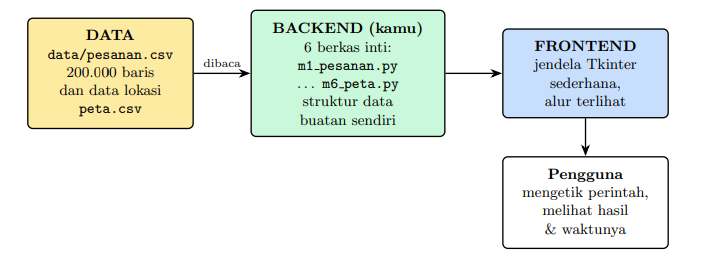

# 2EZ4U - Food Delivery System 
Aplikasi delivery service tiruan (seperti GoFood/GrabFood/ShopeeFood versi mini) yang dikembangkan sebagai Proyek Akhir mata kuliah Struktur Data & Analisa Algoritma. Proyek ini menggunakan Python 3.11+ dengan implementasi struktur data dan algoritma buatan sendiri (tanpa menggunakan fungsi instan bawaan seperti dict, set, sorted(), heapq, dll.).

## Deskripsi Modul
### Modul 1: Array & Linked List
Penyimpanan dan pengelolaan data pesanan dasar menggunakan dua struktur data yang diadu langsung kinerjanya, yaitu Array (dengan alokasi memori dinamis dan amortized $O(1)$) serta Linked List (menggunakan penunjuk head dan tail). Aturan bisnis pada modul ini mengakomodasi tiga jenis pesanan dengan titik penyisipan yang berbeda, yakni pesanan Reguler yang masuk di barisan paling belakang, pesanan Prioritas yang menyerobot ke tengah barisan, serta pesanan VIP yang langsung menempati urutan pertama. Di samping itu, modul ini juga menyediakan fungsi mendasar untuk melihat detail satu pesanan serta menghapus pesanan dari antrean.  

### Modul 2: Stack & Queue
Mengimplementasikan struktur data Stack (tumpukan) dan Queue (antrean) guna menangani operasional kasir dan dapur secara efisien. Stack digunakan pada mesin kasir untuk mengonversi ekspresi infix menjadi postfix sekaligus mengevaluasi total harga belanjaan, serta mendukung fitur Undo/Redo untuk membatalkan atau mengerjakan ulang aksi terakhir. Selain itu, modul ini membandingkan dua versi antrean (Queue), yaitu Queue Naif yang memerlukan pergeseran elemen secara manual saat dequeue ($O(n)$) dan Queue Melingkar / Circular Queue yang memanfaatkan penunjuk front, rear, serta operasi modulo agar proses pengambilan data menjadi sangat cepat ($O(1)$) tanpa ada elemen yang digeser.

### Modul 3: Sorting & Searching
Menangani pembuatan laporan harian dan pencarian data spesifik dengan menerapkan berbagai algoritma pengurutan dan pencarian lengkap bersama pencatat jumlah perbandingannya. Untuk pengurutan (Sorting), modul ini menyediakan Insertion Sort ($O(n^2)$) yang stabil dan cocok untuk data kecil atau hampir terurut, serta Merge Sort ($O(n \log n)$) yang handal dan stabil dalam mengurutkan data skala besar (seperti 200.000 baris pesanan). Sementara itu, untuk pencarian (Searching), modul ini mengimplementasikan Linear Search ($O(n)$) yang menelusuri data satu per satu tanpa syarat terurut, serta Binary Search ($O(\log n)$) yang membuang separuh sisa data di setiap langkah untuk memberikan hasil pencarian kilat pada data yang sudah terurut menurut kunci tertentu.

## Struktur Repository
```
2EZ4U/
│
├── README.md
├── data/
│   ├── peta.csv
│   └── pesanan.csv
├── backend/
│   ├── m1_pesanan.py
│   ├── m2_antrean.py
│   ├── m3_laporan.py
│   ├── m4_pencarian.py
│   ├── m5_katalog.py
│   └── m6_peta.py
├── frontend/
│   └── ui.py
└── app.py
```

### Root Directory ``2EZ4U/``
- `README.md`: Berisi dokumentasi utama proyek, deskripsi aplikasi, panduan instalasi, cara menjalankan program, diagram, serta catatan penting lainnya.   
- `app.py`: Berfungsi sebagai file utama aplikasi (main application) yang menginisialisasi program dan menjalankan antarmuka utama.  
### Folder ``Data/``
Berfungsi sebagai tempat penyimpanan berkas data sistem dalam format CSV (seperti ``pesanan.csv`` dengan 200.000 baris data transaksi dan `peta.csv` untuk data jaringan lokasi) yang bertindak sebagai database tiruan bagi aplikasi.

### Folder ``backend/``
Berisi kode inti dari sistem yang mengimplementasikan berbagai struktur data dan algoritma buatan sendiri. Folder ini terbagi menjadi modul-modul fungsional (seperti pengelolaan pesanan, antrean, laporan terurut, pencarian, katalog, hingga peta dan navigasi graf) yang dipanggil oleh layer antarmuka.

### Folder ``frontend/``
Berisi komponen antarmuka pengguna grafis (GUI) berbasis jendela Tkinter. Di dalam folder ini terdapat file ``ui.py`` yang mengatur tata letak, komponen menu, serta tampilan visual alur interaksi antara pengguna dan sistem backend.

## Diagram Implementasi


## Cara Menjalankan Aplikasi
1. Pastikan Python 3.11+ telah terinstal dalam sistem. 
2. Clone repository ke dalam komputer.
3. Navigasi menuju folder root directory 2EZ4U pada terminal/command prompt
4. Jalankan aplikasi utama melalui terminal/command prompt menggunakan perintah: ``python3 app.py``